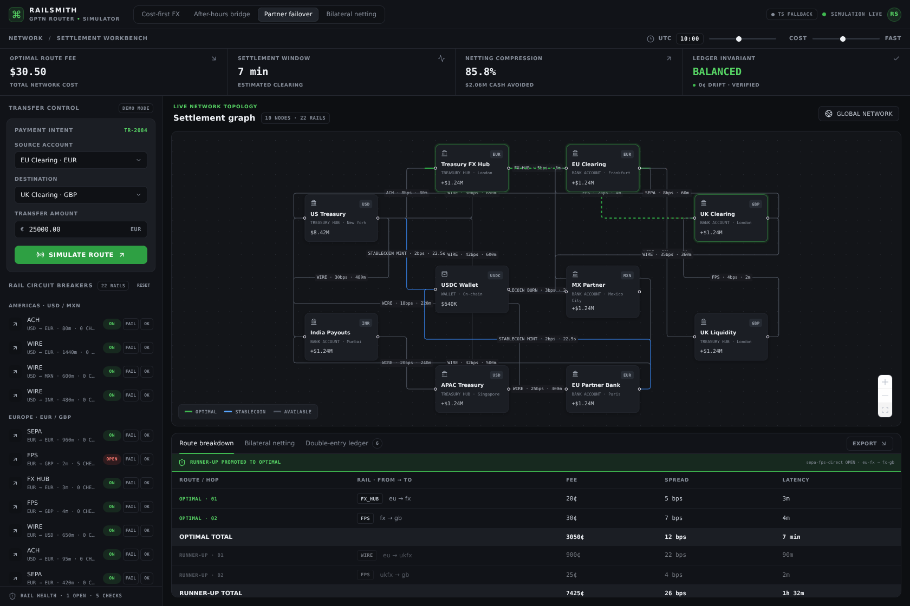
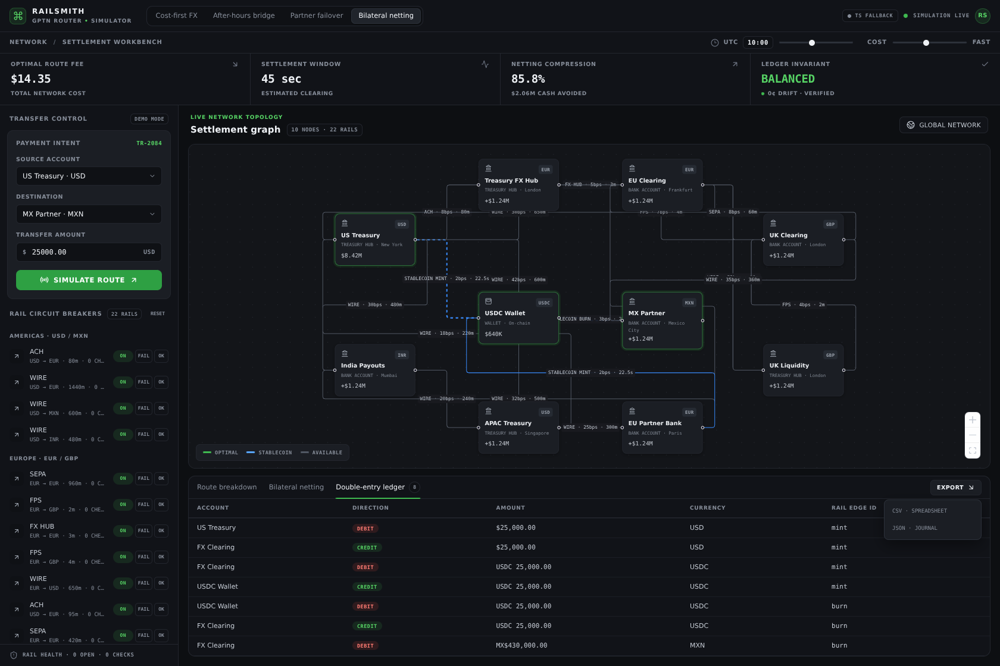

# RailSmith — GPTN Router

RailSmith is an interactive multi-rail payments and FX routing workbench. It models accounts and settlement rails as a directed graph, compares optimal and alternate routes, simulates rail failures, and produces a balanced multi-currency ledger.

## Screenshots

The screenshots below capture the running workbench in its TypeScript fallback mode. The same UI connects to the Ruby engine when its API is running.

### Routing workbench

Compare the optimal route with its runner-up while viewing the live settlement graph, rail health controls, cutoffs, fees, and latency.


### Circuit-breaker failover

The Partner failover scenario records rail failures, opens the breaker, recomputes the route, and promotes the available alternate path.



### Bilateral netting

Review the demo batch's gross volume, compressed settlement amount, saved cash, and compression rate.


### FX ledger and export

Inspect multi-currency double-entry postings, including FX-clearing entries, and choose CSV or JSON export.



## Features

- **Cost-versus-speed routing:** find the lowest weighted route and quote a runner-up for failover.
- **Live rail simulation:** submit success or failure observations, inspect per-rail sample counts and error rates, and let the circuit breaker open or recover circuits.
- **Bilateral netting:** compress opposing instructions on the same currency corridor.
- **FX-aware ledger:** apply each rail's scaled FX rate to the amount carried to the next hop; FX-clearing entries keep postings balanced per currency.
- **CSV and JSON export:** download the current journal, with per-currency totals and balance status in JSON.
- **Graceful offline mode:** the UI uses the bundled TypeScript engine when the Ruby API is unavailable.

## Requirements

- Node.js 20 or newer and npm
- Ruby 3.1 or newer with Bundler (for the Ruby engine and Ruby checks)

## Run locally

Start the Ruby API in one terminal:

```sh
cd ruby
bundle install
bundle exec ruby bin/railsmith-api
```

The API listens on `http://0.0.0.0:8080` by default. To choose another port, set `PORT`, for example `PORT=9090 bundle exec ruby bin/railsmith-api`; if you do, update the `/api` proxy target in `vite.config.ts` to match.

Start the UI in a second terminal from the repository root:

```sh
npm ci
npm run dev
```

Open the Vite URL printed in the terminal (normally `http://localhost:5173`). Vite proxies `/api` requests to the Ruby API. If Ruby is not running, the UI switches to the TypeScript fallback automatically.

## Checks

From the repository root:

```sh
npm run typecheck
npm run build
```

For Ruby tests and Sorbet typechecking:

```sh
cd ruby
bundle exec rake
bundle exec srb tc
```

## API

The Ruby service exposes these endpoints:

| Method | Path | Purpose |
| --- | --- | --- |
| `GET` | `/api/health` | Check engine availability |
| `GET` | `/api/graph` | Fetch demo accounts and rails |
| `POST` | `/api/route` | Get an optimal route and runner-up |
| `POST` | `/api/net` | Net a batch of transfer instructions |
| `POST` | `/api/ledger` | Generate a balanced journal for a route |
| `POST` | `/api/circuit-breaker` | Replay rail outcomes and return breaker state |

## Project layout

```text
ruby/                 Sorbet-typed payment engine and HTTP API
src/engine/           TypeScript routing, netting, ledger, and API client
src/ui/               React workbench and styles
docs/screenshots/     Workbench screenshots
```
