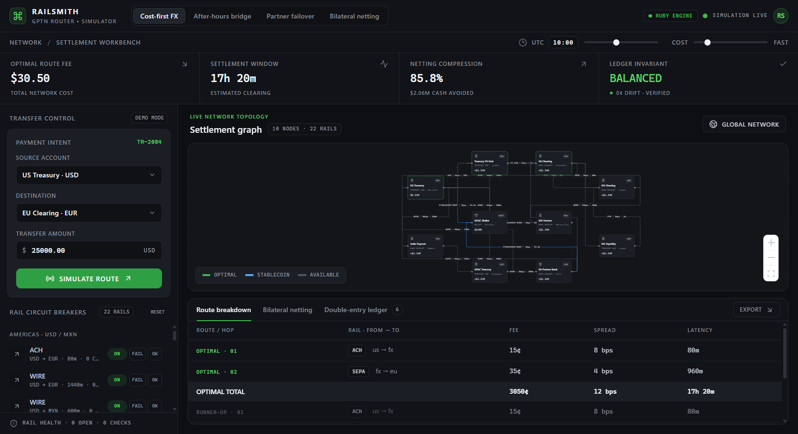
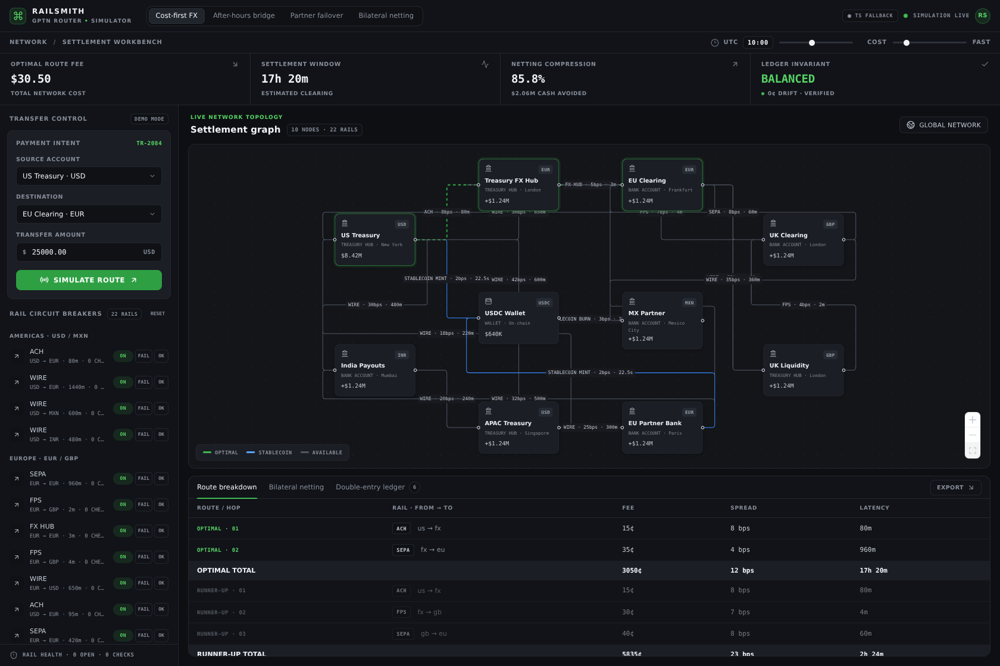
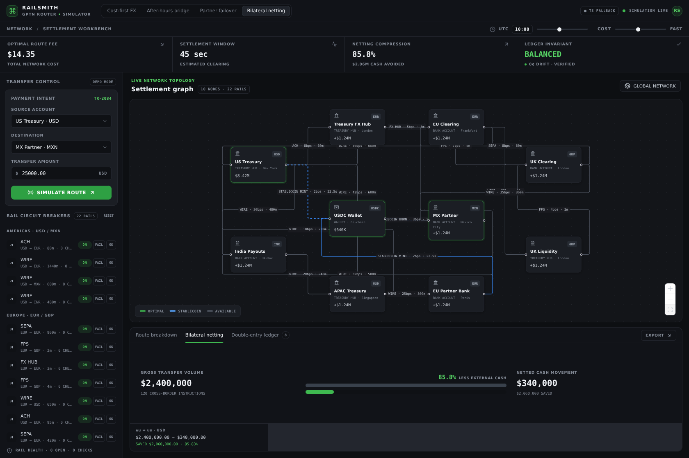

# RailSmith — GPTN Router

> **Live Demo:** [https://sehaan-1.github.io/RailSmith/](https://sehaan-1.github.io/RailSmith/)

RailSmith is an interactive multi-rail payments and FX routing workbench. It models accounts and settlement rails as a directed graph, compares optimal and alternate routes, simulates rail failures, and produces a balanced multi-currency ledger.

## Screenshots

The screenshots below capture the running workbench connected to the live **Ruby engine**, as well as the offline TypeScript fallback mode.

### Live workbench (Ruby engine)

Connected to the Sorbet-typed Ruby API on port 8080. The engine computes constrained Dijkstra routing, quotes runner-up failovers, and balances double-entry ledgers directly from Ruby:



### Routing workbench (TypeScript fallback)

When offline, the bundled TypeScript engine takes over automatically with zero drift in graph schema or serialization:



### Circuit-breaker failover

The Partner failover scenario records rail failures, opens the breaker, recomputes the route, and promotes the available alternate path:


### Bilateral netting

Review the demo batch's gross volume, compressed settlement amount, saved cash, and compression rate:



### FX ledger and export

Inspect multi-currency double-entry postings, including FX-clearing entries, and choose CSV or JSON export:


## Features

- **Cost-versus-speed routing:** find the lowest weighted route and quote a runner-up for failover.
- **Live rail simulation:** submit success or failure observations, inspect per-rail sample counts and error rates, and let the circuit breaker open or recover circuits.
- **Bilateral netting:** compress opposing instructions on the same currency corridor.
- **FX-aware ledger:** apply each rail's scaled FX rate to the amount carried to the next hop; FX-clearing entries keep postings balanced per currency.
- **CSV and JSON export:** download the current journal, with per-currency totals and balance status in JSON.
- **Graceful offline mode:** the UI uses the bundled TypeScript engine when the Ruby API is unavailable.

## Requirements

- Node.js 20 or newer and npm
- Ruby 3.1 or newer with Bundler (for the Ruby engine and Ruby checks)

## Run locally

### Default: Start with the Ruby engine

Start both the Ruby engine API (port 8080) and the Vite development server (port 5173) with a single command:

```sh
npm start
```

Open `http://localhost:5173` in your browser. The top-right badge will show **RUBY ENGINE** active.

### Alternative: Run services separately

Start the Ruby API in one terminal:

```sh
cd ruby
bundle install
bundle exec ruby bin/railsmith-api
```

The API listens on `http://0.0.0.0:8080` by default. To choose another port, set `PORT`, for example `PORT=9090 bundle exec ruby bin/railsmith-api`; if you do, update the `/api` proxy target in `vite.config.ts` to match.

Start the UI in a second terminal from the repository root:

```sh
npm ci
npm run dev
```

Open `http://localhost:5173`. Vite automatically proxies `/api` requests to the Ruby API. If Ruby is not running, the UI switches to the TypeScript fallback automatically.

## Deploying to Cloud

### 1. Deploy the Ruby Engine (Free on Render)

Deploy the Sorbet-typed Ruby API backend as a free web service using the included `render.yaml` blueprint or Dockerfile:

[](https://render.com/deploy?repo=https://github.com/Sehaan-1/RailSmith)

1. Click the **Deploy to Render** button above or connect your GitHub repository in [Render](https://render.com).
2. Once deployed, Render provides your backend service URL (e.g. `https://railsmith-engine.onrender.com`).
3. In your GitHub repository, navigate to **Settings > Secrets and variables > Actions > Variables** and set:
   - `VITE_API_URL`: `https://your-backend.onrender.com`
4. Re-running the GitHub Pages deployment will connect the live frontend directly to the remote Ruby service!

## Checks

From the repository root:

```sh
npm run typecheck
npm run build
```

For Ruby tests and Sorbet typechecking:

```sh
cd ruby
bundle exec rake
bundle exec srb tc
```

## API

The Ruby service exposes these endpoints:

| Method | Path | Purpose |
| --- | --- | --- |
| `GET` | `/api/health` | Check engine availability |
| `GET` | `/api/graph` | Fetch demo accounts and rails |
| `POST` | `/api/route` | Get an optimal route and runner-up |
| `POST` | `/api/net` | Net a batch of transfer instructions |
| `POST` | `/api/ledger` | Generate a balanced journal for a route |
| `POST` | `/api/circuit-breaker` | Replay rail outcomes and return breaker state |

## Project layout

```text
ruby/                 Sorbet-typed payment engine and HTTP API
scripts/              Development startup orchestration
src/engine/           TypeScript routing, netting, ledger, and API client
src/ui/               React workbench and styles
docs/screenshots/     Workbench screenshots
```
